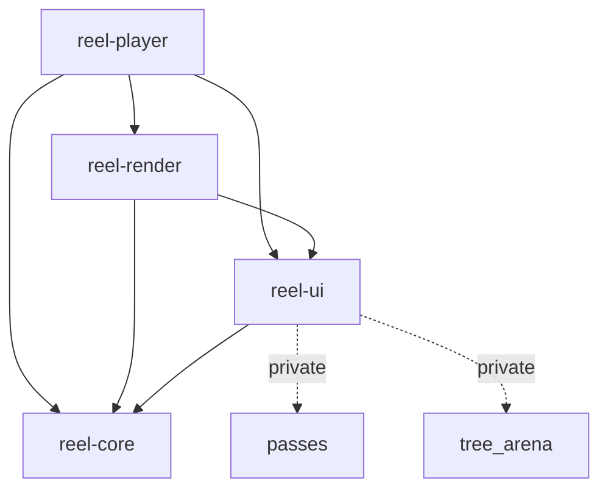

# Issue #34 UI consolidation

Base: `7990c326f1acf3531a940134eab38bd55c66f214`.
Tested source: `228b19485ed85673195817b45943f7d1592990c5`.
Branch: `issue-34-reel-ui`. Later changes in this delivery are documentation only.

The UI implementation is one unpublished `reel-ui` package with the workspace
version and Reel repository metadata. It owns widgets, properties, geometry,
input, portable frames and resource leases. Public modules are
`core/app/layout/properties/widgets/theme/bridge/frame/resources`, with maintained
`doc/util` helpers; traversal `passes` and the safe `tree_arena` are private.
Both property collections are merged into actual sibling definitions. There is
no enclosing masonry/masonry_core/stage module and no forwarding package.

The [module responsibility table](README.md) describes the internal ownership.
Presentation candidates and acceptance now use `reel_ui::bridge`; drawing export
uses `reel_ui::frame`; resource preparation/leases use `reel_ui::resources`.
Common geometry/record/text types are still re-exported from one dependency source.

Removed crates: `masonry`, `masonry_core`, `tree_arena`, `reel-stage`, and
`linebender_include_doc_path` (directory `include_doc_path`). Workspace and root
lock contain only the new UI package. The unused unsafe tree, no_std/safe_tree
feature split, upstream versions/configuration, source-layout whitelist, old
experimental project/lock/patch replay and `prepare-masonry` entry are retired.
Original Apache license, copyright and unchanged screenshots remain;
[ORIGIN.md](ORIGIN.md) records the source and local changes. No imported NOTICE
was present. Upstream synchronization/contribution is not a maintenance goal.

The old contract tool's useful group, disabled-route, terminal-removal, root-layer
and frozen-input assertions already live in the migrated production
`tests/support/{checks,presentation}.rs`. Tests expecting the unadapted upstream
input gap are historical at the fixed pre-integration base, rather than a current
runnable alternate project. All 343 original stage/safe-tree assertion statements
survive the migration; the child selector also asserts exactly one executed test.
This source check supports review; the actual runtime checks below establish behavior.

All 22 renderer/player production files match the accepted base after removing
imports and normalizing package paths/whitespace. No renderer/player algorithm
was changed. UI internal cancellation access is encapsulated by bridge methods.
Debug-only state/layout/arena helpers are explicitly scoped so release builds
need no global unused-code suppression. Production unsafe code remains forbidden.

## Actual validation

2026-10-09, Linux x86_64, Rust 1.96.0. System dependencies/toolchain were installed
outside the repository in the workspace. Native checks used Xvfb and Vulkan
llvmpipe (LLVM 19.1.7, Mesa 25.0.7), RGBA16Float/4x MSAA; these are software-device
results. The font was installed OpenSans-Regular.ttf. Raw logs, Cargo JSON,
Rust supporting check sources/binaries and initial resolved environment failures
are ignored under `target/reel-artifacts/issue-34/`.

| Check | Result and evidence filename |
| --- | --- |
| fmt; strict all-target/all-feature Clippy in debug/release | Pass, no warnings; `fmt.log`, `clippy.log`, `clippy-release.log` |
| UI/render/player/core default-off production builds in debug/release | Pass; `build-default-off-{debug,release}.log` |
| Default-off tests in both profiles | Pass; `default-off-{debug,release}.log`; core/test-support is enabled only for contract fixtures |
| Native-feature tests in both profiles | Pass; `native-{debug,release}.log` |
| Explicit GPU pixels/correctness and actual window in both profiles | All 10 GPU tests and the window test pass; `device-window-{debug,release}-final.log` |
| Real Parley in both profiles | One run / 14 positioned glyphs copied without reshaping; `parley-{debug,release}.log` |
| Pixel glyph path | 14 Parley glyphs, 593 Swash-covered pixels in both profiles |
| Legal/source/dependency audit | Pass; `audit-ui.log`; original license hash/headers, provenance, nested-Git guard, one local UI/type source and no reverse native dependency |
| Dependency guard negative cases | Pass; `maintenance-tests.log`; retired/duplicate/remote UI and transitive normal/build GPU pollution rejected |
| Existing Rust read-only maintenance check | Pass; `tool-check.log`; no source execution |
| Strict rustdoc and local images | Pass; `doc.log`, `doc-images.log`; generated HTML embeds the exact original three PNGs |
| Consumer and assertion preservation | Pass; `source-preservation.log` |
| Migrated exact Cargo measurement selection | Pass; `measure-{contracts,rect,path,control}.log` and corresponding launcher logs |

The 24 UI input/geometry contracts, 14 ordinary R01 frame/resource contracts,
private safe-tree scope/reparent/remove/busy-workspace checks and separate
whole-dispatch allocation probe are retained and run. Warmed uncaptured pointer
hit/miss at 32/256/1024 controls asserts zero allocation/reallocation. The lookup
binary retains small-stack find/find_mut, capacities 1/32/128/depth, deep scope and
zero allocation/reallocation, including release depth 2048 on a 64 KiB stack.
Its subprocess selector is `lookup_probe::lookup_child`, checked against exactly
one completed test; allocator instrumentation is isolated from pointer probes.
Candidate eligibility, accepted geometry, key/view accounting, cancellation,
resource lease retirement and budget refusal/recovery assertions pass.

The native window test verifies real acquisition/retry, Expose replay of a frozen
accepted CPU frame, permanent refusal preserving accepted geometry, device
recreation with increasing generation/epoch, suspend/resume and shutdown.
Linear pixels, transformed clips, groups/masks, quality downgrade, resource and
completion retention, localized refusal, foreign-device handling and crossfade
are checked through the actual renderer readback path.

The single-process release measurement observations below are diagnostics, not
performance guarantees or comparisons against a different host:

| Workload | Record | Full setup/export/finish | Largest step | GNU time peak RSS |
| --- | ---: | ---: | ---: | ---: |
| 512 rectangles | 218.664 µs | 657.464 µs | 135.201 µs | 4,260 KiB |
| 16 paths × 2,048 elements | 1.327617 ms | 3.203267 ms | 58.697 µs | 10,084 KiB |

Source/cache residency, paused/complete/cancelled ownership and drop costs remain
separate in the raw logs. All measurement processes and the `/bin/true` launch
control exit 0. The first attempt lacked GNU time; its failure is retained, then
the local tool was installed and all four real runs completed successfully.

## Integration handoff

Architecture/index/creator-guide edits remain with the parent, as instructed.
Suggested exact updates:

- `docs/engine-architecture.md`: module/dependency list and source-maintenance
  rules (§2), portable frame ownership (§8/§16), UI adaptation terminology (§15),
  and current R01 links to `crates/reel-ui`.
- `docs/README.md`: current package/status list and UI entry link.
- `docs/guide/{zh-CN,en}.md`: relocate R01 report links and synchronize the
  self-maintained UI explanation; preserve their shared Aside snippets.

This branch stays on the accepted `7990` base. PR33 has not been merged into it.
Final combination review waits for the parent's accepted new-main notification.
Author node/DSL/image-slider work and platform IME/accessibility/touch adapters
retain their existing boundaries. No V03, Aside source executor or Actions was run.
