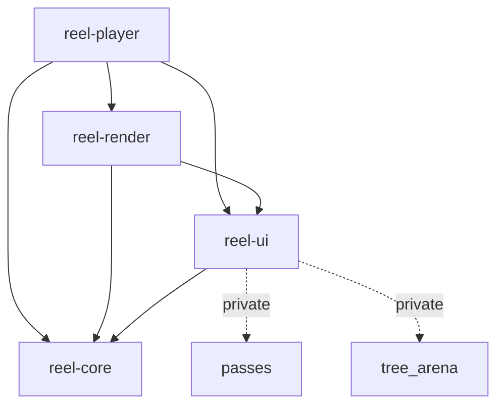

# Issue #34 UI consolidation

Base: `7990c326f1acf3531a940134eab38bd55c66f214`.
Tested consolidation source: `228b19485ed85673195817b45943f7d1592990c5`.
Branch: `issue-34-reel-ui`. The accepted R03 combination and subsequent measurement
selector repair are recorded separately below.

The UI implementation is one unpublished `reel-ui` package with the workspace
version and Reel repository metadata. It owns widgets, properties, geometry,
input, portable frames and resource leases. Public modules are
`core/app/layout/properties/widgets/theme/bridge/frame/resources`, with maintained
`doc/util` helpers; traversal `passes` and the safe `tree_arena` are private.
Both property collections are merged into actual sibling definitions. There is
no enclosing masonry/masonry_core/stage module and no forwarding package.

The [module responsibility table](README.md) describes the internal ownership.
Presentation candidates and acceptance now use `reel_ui::bridge`; drawing export
uses `reel_ui::frame`; resource preparation/leases use `reel_ui::resources`.
Common geometry/record/text types are still re-exported from one dependency source.

Removed crates: `masonry`, `masonry_core`, `tree_arena`, `reel-stage`, and
`linebender_include_doc_path` (directory `include_doc_path`). Workspace and root
lock contain only the new UI package. The unused unsafe tree, no_std/safe_tree
feature split, upstream versions/configuration, source-layout whitelist, old
experimental project/lock/patch replay and `prepare-masonry` entry are retired.
Original Apache license, copyright and unchanged screenshots remain;
[ORIGIN.md](ORIGIN.md) records the source and local changes. No imported NOTICE
was present. Upstream synchronization/contribution is not a maintenance goal.

The old contract tool's useful group, disabled-route, terminal-removal, root-layer
and frozen-input assertions already live in the migrated production
`tests/support/{checks,presentation}.rs`. Tests expecting the unadapted upstream
input gap are historical at the fixed pre-integration base, rather than a current
runnable alternate project. All 343 original stage/safe-tree assertion statements
survive the migration; the child selector also asserts exactly one executed test.
This source check supports review; the actual runtime checks below establish behavior.

All 22 renderer/player production files match the accepted base after removing
imports and normalizing package paths/whitespace. No renderer/player algorithm
was changed. UI internal cancellation access is encapsulated by bridge methods.
Debug-only state/layout/arena helpers are explicitly scoped so release builds
need no global unused-code suppression. Production unsafe code remains forbidden.

## Actual validation

2026-10-09, Linux x86_64, Rust 1.96.0. System dependencies/toolchain were installed
outside the repository in the workspace. Native checks used Xvfb and Vulkan
llvmpipe (LLVM 19.1.7, Mesa 25.0.7), RGBA16Float/4x MSAA; these are software-device
results. The font was installed OpenSans-Regular.ttf. Raw logs, Cargo JSON,
Rust supporting check sources/binaries and initial resolved environment failures
are ignored under `target/reel-artifacts/issue-34/`.

| Check | Result and evidence filename |
| --- | --- |
| fmt; strict all-target/all-feature Clippy in debug/release | Pass, no warnings; `fmt.log`, `clippy.log`, `clippy-release.log` |
| UI/render/player/core default-off production builds in debug/release | Pass; `build-default-off-{debug,release}.log` |
| Default-off tests in both profiles | Pass; `default-off-{debug,release}.log`; core/test-support is enabled only for contract fixtures |
| Native-feature tests in both profiles | Pass; `native-{debug,release}.log` |
| Explicit GPU pixels/correctness and actual window in both profiles | All 10 GPU tests and the window test pass; `device-window-{debug,release}-final.log` |
| Real Parley in both profiles | One run / 14 positioned glyphs copied without reshaping; `parley-{debug,release}.log` |
| Pixel glyph path | 14 Parley glyphs, 593 Swash-covered pixels in both profiles |
| Legal/source/dependency audit | Pass; `audit-ui.log`; original license hash/headers, provenance, nested-Git guard, one local UI/type source and no reverse native dependency |
| Dependency guard negative cases | Pass; `maintenance-tests.log`; retired/duplicate/remote UI and transitive normal/build GPU pollution rejected |
| Existing Rust read-only maintenance check | Pass; `tool-check.log`; no source execution |
| Strict rustdoc and local images | Pass; `doc.log`, `doc-images.log`; generated HTML embeds the exact original three PNGs |
| Consumer and assertion preservation | Pass; `source-preservation.log` |
| Initial migrated measurement runs | Pass; `measure-{contracts,rect,path,control}.log` and corresponding launcher logs; selector negative cases were repaired in the combination below |

The 24 UI input/geometry contracts, 14 ordinary R01 frame/resource contracts,
private safe-tree scope/reparent/remove/busy-workspace checks and separate
whole-dispatch allocation probe are retained and run. Warmed uncaptured pointer
hit/miss at 32/256/1024 controls asserts zero allocation/reallocation. The lookup
binary retains small-stack find/find_mut, capacities 1/32/128/depth, deep scope and
zero allocation/reallocation, including release depth 2048 on a 64 KiB stack.
Its subprocess selector is `lookup_probe::lookup_child`, checked against exactly
one completed test; allocator instrumentation is isolated from pointer probes.
Candidate eligibility, accepted geometry, key/view accounting, cancellation,
resource lease retirement and budget refusal/recovery assertions pass.

The native window test verifies real acquisition/retry, Expose replay of a frozen
accepted CPU frame, permanent refusal preserving accepted geometry, device
recreation with increasing generation/epoch, suspend/resume and shutdown.
Linear pixels, transformed clips, groups/masks, quality downgrade, resource and
completion retention, localized refusal, foreign-device handling and crossfade
are checked through the actual renderer readback path.

The single-process release measurement observations below are diagnostics, not
performance guarantees or comparisons against a different host:

| Workload | Record | Full setup/export/finish | Largest step | GNU time peak RSS |
| --- | ---: | ---: | ---: | ---: |
| 512 rectangles | 218.664 µs | 657.464 µs | 135.201 µs | 4,260 KiB |
| 16 paths × 2,048 elements | 1.327617 ms | 3.203267 ms | 58.697 µs | 10,084 KiB |

Source/cache residency, paused/complete/cancelled ownership and drop costs remain
separate in the raw logs. All measurement processes and the `/bin/true` launch
control exit 0. The first attempt lacked GNU time; its failure is retained, then
the local tool was installed and all four real runs completed successfully.

## Combination with accepted R03 main

The parent's architecture, index and bilingual-guide updates were fast-forwarded
through `6778d126d4a95109bb821dd4416ca1a1b2262c31`. Normal merge
`17295a64d46e970b1d2a10e6070a36b0af6e8816` then incorporated accepted main
`3962819f75ae3cdd9dbd0d2be4dba79da5c1e8ac`, including PR #33 and its owner
documentation. Five mechanical conflicts preserved both the UI and R03 paragraphs,
selected R03's PipelineSlots import, and migrated test/command paths to reel-ui.
No behavioral conflict or renderer/player algorithm change was introduced.

The ten new pipeline regressions now consume the maintained UI fixtures directly.
Rust source comparison against the accepted new main confirms all 22 renderer/player
production files are equivalent after import/path/whitespace normalization; the
R03 pipeline implementation is byte-identical. All ten R03 regression functions
and their 64 assertion statements are preserved, alongside all 343 original
stage/safe-tree assertion statements from the original consolidation base.

Independent review found a pre-existing measurement selector weakness: manifest
substring matching admitted foreign manifests, and a second candidate silently
replaced the first. Separate fix `e8383148d42a51e7c21aa794751cec7c5b620a60`
validates Cargo metadata's exact local package ID/manifest, integration-test source,
release test profile and Cargo artifact path; multiple candidates fail. Before
launch, the selected harness must list the required measurement tests. Real runs
must report their named successful completion. The standalone launch control
validates the same artifact/inventory before timing `/bin/true`.

Combined tested source: `e8383148d42a51e7c21aa794751cec7c5b620a60`.
The same Linux/Rust/font/software Vulkan environment described above was used.
Raw commands, logs, Rust supporting programs and the complete 27-check result list
are ignored under `target/reel-artifacts/issue-34/composed-main-3962819/`.
Later changes only record these results.

| Combined check | Actual result and evidence |
| --- | --- |
| fmt; selected all-target/all-feature strict Clippy, debug/release | Pass; `fmt.log`, `clippy-{debug,release}.log` |
| UI/render/player/core default-off production builds and tests, both profiles | Pass; `default-off-{build,tests}-{debug,release}.log`; test-only core/test-support fixtures |
| Native-feature contracts, zero-allocation pointer/deep-tree probes, candidate/geometry/budget/resource leases, both profiles | Pass; `native-tests-{debug,release}.log` |
| R03 explicit pipeline regressions, both profiles | Exactly ten pass each; `pipeline10-{debug,release}.log`; internal scope confirmation, outer scopes, cross-slot cold lock, sticky failures and Pending refusal retained |
| Original GPU pixels/correctness, both profiles | All ten pass each; `gpu-original-{debug,release}.log` |
| Actual Parley, both profiles | One run / 14 glyphs each; `parley-{debug,release}.log` |
| Actual Xvfb window Expose/retry/accepted geometry/generation-epoch recovery/shutdown, both profiles | One window test passes each; `window-expose-{debug,release}.log` |
| Dependency direction, legal/source audit and negative metadata controls | Pass; `deps.log`, `audit-ui.log`, `maintenance-ui.log` |
| Measure Rust negative regressions | Two pass; `maintenance-measure.log` |
| Measure CLI negative controls | Foreign manifest, ambiguous candidates, empty filter, skipped probe, list-only and omitted ignored probe all exit 1 before measurement launch; `measure-cli-controls.log` and six individual logs |
| Measure actual release positive controls | Contracts: 24 tests; rect/path: one probe each; launch control: exit 0; `measure-{contracts,rect,path,control}-launch.log` and matching raw logs |
| Bilingual guides, parse/prefix recovery and semantic analysis only, both profiles | Two parse tests and one semantic test pass each, covering 24 matching scenes; `guide-{debug,release}.log` |
| Consumer/R03/assertion preservation and read-only fixture maintenance | Pass; `source-preservation.log`, `read-only-check.log` |

The current PR stays draft for independent integration review. Browser WebGPU,
physical GPU faults/hot-unplug, Wayland and native Windows/macOS remain unverified.
Driver allocations remain outside the hard frame/resource byte budget. CPU timings
are software-device environment observations, not physical-GPU performance guarantees.
Author node/DSL/image-slider work and platform IME/accessibility/touch adapters
retain their existing boundaries. No V03, Aside source executor or Actions was run.
